# Tecnologias educacionais, jogos digitais e experiências interativas

**Prof. Mário César Nascimento, PhD — professor universitário, designer e desenvolvedor de tecnologias educacionais e jogos digitais.**

Minha atuação integra conhecimento científico, **tecnologia educacional (EdTech)**, **design de aprendizagem** e **desenvolvimento assistido por inteligência artificial**. Crio plataformas, simuladores, tutores e experiências em 3D e realidade aumentada para explorar Fisiologia Humana, Ética e Metodologia da Pesquisa.

Conduzo a concepção dos projetos, a definição de conteúdos e regras, a orientação da implementação e a revisão da experiência de uso. Na **Dragon Games**, projeto criado com **Osana Melo Nascimento**, desenvolvo jogos de dedução, investigação e tomada de decisão para aprendizagem e entretenimento. Cada obra preserva seus créditos próprios.

**English — professional profile:** University professor, designer and developer of educational technologies and digital games. My work combines scientific knowledge, learning design and AI-assisted development to create platforms, simulators, tutors, 3D and augmented reality experiences, and games for learning and entertainment. Dragon Games was created with Osana Melo Nascimento; each project retains its own credits.

## Guia do portfólio — 25 de outubro de 2026

[**Conhecer as experiências do site**](https://www.drmarionascimento.com.br/#acesso-publico) · [Inventário detalhado de acesso](DISPONIBILIDADE.md) · [Regras de manutenção para agentes](AGENTS.md)

Este portfólio reúne **recursos de estudo individual**, **experiências abertas à avaliação do público** e **ferramentas para professores conduzirem atividades em sala**. Uma atividade pode pertencer a mais de uma categoria: a finalidade pedagógica não determina, por si só, se exige autenticação.

### 1. O que existe no portfólio

| Frente | Projetos e experiências | Finalidade |
|---|---|---|
| **Fisiologia Humana** | [Fisiologia Interativa](https://fisiologia.drmarionascimento.com.br/), [Fisiologia em Fuga](https://fisiologia-em-fuga.drmarionascimento.com.br/) e [Percursos de Fisiologia](https://fisiologia-em-fuga.drmarionascimento.com.br/percursos/) | Exploração, simulação, investigação e revisão de mecanismos fisiológicos |
| **Ética** | [Casos Éticos 1](https://etica.drmarionascimento.com.br/casos-eticos/), [Casos Éticos 2](https://etica.drmarionascimento.com.br/historias-eticas/), [Dilema do Bonde](https://etica.drmarionascimento.com.br/dilema-bonde/) e [Comitê de Ética Profissional](https://comite-etica.drmarionascimento.com.br/) | Decisões, consequências, argumentação e deliberação ética |
| **Metodologia da Pesquisa** | [Laboratório do Pesquisador](https://laboratorio-de-pesquisa.drmarionascimento.com.br/) | Delineamentos e instrumentos de pesquisa |
| **Jogos e experiências coletivas** | [Eita!](https://eita.dragongames.dev.br/), [MOSAICO · Sala](https://mosaico-sala.web.app/planejar.html), [Mosaico Card](https://mosaico-card.dragongames.dev.br/) e [Dragon Games](https://dragongames.dev.br/) | Aprendizagem por desafios, investigação, cooperação e tomada de decisões |
| **Ferramentas de aula** | [Atividades Extras](https://atividades-extras.drmarionascimento.com.br/) | Professor organiza, configura e acompanha atividades com sua turma |
| **Experimentação técnica** | [Lab-RA](https://lab-ra.dragongames.dev.br/bancadas.html) | Protótipos e experiências em realidade aumentada, respeitando as condições de cada projeto |
| **Projetos relacionados** | [NutriCiclos — sistema](https://github.com/DrMarioNascimento/NutriCiclosSistemas) e [manual](https://github.com/DrMarioNascimento/NutriCiclos-manual) | Frente independente, com direitos e disponibilidade próprios |

### 2. Recursos destinados aos cursos

| Recurso | Educação Física | Fisioterapia | Acesso |
|---|---|---|---|
| **Fisiologia Interativa** | [Área de EF](https://fisiologia.drmarionascimento.com.br/) | [Área de Fisioterapia](https://fisiologia.drmarionascimento.com.br/fisioterapia/) | Público, sem cadastro |
| **Tutores de Fisiologia** | [Tutor EF](https://fisiologia.drmarionascimento.com.br/tutor-ef.html) | [Tutor Fisioterapia](https://fisiologia.drmarionascimento.com.br/tutor-fisio.html) | Páginas públicas; integrações Moodle seguem os ambientes respectivos |
| **Fisiologia em Fuga — escape rooms** | Salas e roteiros próprios de EF | Salas e roteiros próprios de Fisioterapia | **Teste público sem Google** |
| **Percursos de Fisiologia** | Compartilhado | Compartilhado | **Teste público sem Google** |

**Regra essencial:** nos escape rooms, **Educação Física e Fisioterapia não devem ser misturadas**: preservar conteúdos, casos, questões, identificação do curso e retorno ao tutor correto. **Percursos de Fisiologia atende aos dois cursos**, com seleção de unidades e contextos; não é uma terceira versão exclusiva de um deles. Os cadeados das salas são parte dos desafios, não senhas de acesso.

### 3. O que está aberto ao público

| Situação | Experiência | Como entrar |
|---|---|---|
| **Disponível ao público** | Fisiologia Interativa (EF e Fisioterapia), tutores e simuladores | Sem cadastro |
| **Disponível ao público** | Casos Éticos 1 e 2; Dilema do Bonde, inclusive versão para celular | Sem cadastro |
| **Disponível ao público** | Laboratório do Pesquisador | Sem cadastro |
| **Teste público aberto** | [Fisiologia em Fuga](https://fisiologia-em-fuga.drmarionascimento.com.br/) — salas distintas de EF e Fisioterapia | **Sem login Google** |
| **Teste público aberto** | [Percursos de Fisiologia](https://fisiologia-em-fuga.drmarionascimento.com.br/percursos/) — para EF e Fisioterapia | **Sem login Google** |
| **Teste aberto com papéis distintos** | [Eita! Quiz](https://eita.dragongames.dev.br/) | Condutor com Google; participantes por código |
| **Planejamento acessível com Google** | [MOSAICO · Planejamento](https://mosaico-sala.web.app/planejar.html) | Login Google para planejamento e exportação; condução e biblioteca de salas têm restrições próprias |

**Testes abertos não significam validação pedagógica integral ou ausência de falhas.** A disponibilidade informa que o acesso é oferecido ao público; não certifica todas as rotas, aparelhos ou cenários.

### 4. O que é destinado à condução do professor

| Ferramenta | Professor | Estudante ou equipe |
|---|---|---|
| [Atividades Extras](https://atividades-extras.drmarionascimento.com.br/) | **Google autorizado** para criar, configurar e acompanhar salas | Entra por código/QR disponibilizado pelo professor, sem conta docente |
| [Comitê de Ética Profissional](https://comite-etica.drmarionascimento.com.br/) | Conta autorizada para criar e administrar a sessão | Participação por código/QR |
| [Casos Éticos 3](https://etica.drmarionascimento.com.br/percursos-eticos/) | Área de revisão do professor, com Google autorizado | Não classificado como teste público aberto |
| [Mosaico Card](https://mosaico-card.dragongames.dev.br/) | Condução por conta autorizada | Participação conforme o convite e as regras da sala |
| **MOSAICO · salas on-line** | Condução e biblioteca sujeitas a autorização própria | Participação conforme as regras da sessão |

**Não confundir:** [Atividades Extras](https://github.com/DrMarioNascimento/Atividades-Extras) é o ambiente de **condução docente de atividades em turma**. [Fisiologia em Fuga](https://github.com/DrMarioNascimento/fisiologia-em-fuga) oferece **salas de escape e Percursos públicos para os alunos**, sem Google. O controle de autorização do professor nunca deve ser transferido para os escapes públicos, nem retirado das funções docentes.

### 5. Projetos em desenvolvimento ou experimentação

- **Histórias MOSAICO / Dragon Games:** *A Casa da Costa*, *A Manhã do Carro-Forte* e *O Eco do Amanhã* permanecem classificados como testes fechados.
- **Mosaico Card:** as modalidades Novo Testamento e Filmes e Séries mantêm acesso restrito conforme o regime de salas.
- **Lab-RA:** biblioteca experimental; a disponibilidade de uma cópia não amplia os direitos ou permissões do projeto de origem.
- **NutriCiclos:** sistema e manual são projetos relacionados, sem classificação automática como testes públicos neste catálogo.

### 6. Autoria, alcance e acompanhamento

O portal apresenta recursos educacionais, experiências públicas e projetos em desenvolvimento, mas **um repositório visível ou um endereço acessível não significa código aberto nem autorização para copiar, adaptar ou republicar**. As licenças e os titulares são definidos por projeto. Dragon/MOSAICO e Mosaico Card preservam a autoria conjunta de **Mário César Nascimento e Osana Melo Nascimento**, e componentes de terceiros conservam os respectivos créditos e licenças.

Os materiais de saúde têm finalidade didática, não constituem diagnóstico, prescrição ou orientação clínica individual. Consulte [LICENSE.md](LICENSE.md) e [DISPONIBILIDADE.md](DISPONIBILIDADE.md).

**English — access overview:** Public study resources include Interactive Physiology, Ethical Cases 1–2, the Trolley Problem and the Research Laboratory. **Physiology Escape Rooms are separate for Physical Education and Physiotherapy; Physiology Pathways are shared by both. Both are in public testing without Google sign-in.** Eita! has open testing with Google for hosts and codes for participants. Teacher-hosted activities, including Atividades Extras, retain authorized Google access for teachers and room-code entry for students. Development projects and licenses retain their individual conditions.

**Prof. Mário César Nascimento, PhD ©**

[Documentação de manutenção do portal](MANUTENCAO-PORTAL.md).
