# Projetos educacionais e experiências interativas

Recursos desenvolvidos pelo **Prof. Mário César Nascimento, PhD**, para aprender explorando, simulando e decidindo. O portfólio reúne Fisiologia, Ética, Metodologia da Pesquisa e jogos. O estudo de Game Design acompanha a criação dessas experiências; cada obra preserva seus créditos próprios.

## Guia do portfólio — 25 de outubro de 2026

[**Conhecer as experiências do site**](https://www.drmarionascimento.com.br/#acesso-publico) · [Inventário detalhado de acesso](DISPONIBILIDADE.md) · [Regras de manutenção para agentes](AGENTS.md)

Este portfólio reúne **recursos de estudo individual**, **experiências abertas à avaliação do público** e **ferramentas para professores conduzirem atividades em sala**. Uma atividade pode pertencer a mais de uma categoria: a finalidade pedagógica não determina, por si só, se exige autenticação.

### 1. O que existe no portfólio

| Frente | Projetos e experiências | Finalidade |
|---|---|---|
| **Fisiologia Humana** | [Fisiologia Interativa](https://fisiologia.drmarionascimento.com.br/), [Fisiologia em Fuga](https://fisiologia-em-fuga.drmarionascimento.com.br/) e [Percursos de Fisiologia](https://fisiologia-em-fuga.drmarionascimento.com.br/percursos/) | Exploração, simulação, investigação e revisão de mecanismos fisiológicos |
| **Ética** | [Casos Éticos 1](https://etica.drmarionascimento.com.br/casos-eticos/), [Casos Éticos 2](https://etica.drmarionascimento.com.br/historias-eticas/), [Dilema do Bonde](https://etica.drmarionascimento.com.br/dilema-bonde/) e [Comitê de Ética Profissional](https://comite-etica.drmarionascimento.com.br/) | Decisões, consequências, argumentação e deliberação ética |
| **Metodologia da Pesquisa** | [Laboratório do Pesquisador](https://laboratorio-de-pesquisa.drmarionascimento.com.br/) | Delineamentos e instrumentos de pesquisa |
| **Jogos e experiências coletivas** | [Eita!](https://eita.drmarionascimento.com.br/), [MOSAICO · Sala](https://mosaico-sala.web.app/planejar.html), [Mosaico Card](https://mosaico-card.dragongames.dev.br/) e [Dragon Games](https://dragongames.dev.br/) | Aprendizagem por desafios, investigação, cooperação e tomada de decisões |
| **Ferramentas de aula** | [Atividades Extras](https://atividades-extras.drmarionascimento.com.br/) | Professor organiza, configura e acompanha atividades com sua turma |
| **Experimentação técnica** | [Lab-RA](https://lab-ra.dragongames.dev.br/bancadas.html) | Protótipos e experiências em realidade aumentada, respeitando as condições de cada projeto |
| **Projetos relacionados** | [NutriCiclos — sistema](https://github.com/DrMarioNascimento/NutriCiclosSistemas) e [manual](https://github.com/DrMarioNascimento/NutriCiclos-manual) | Frente independente, com direitos e disponibilidade próprios |

### 2. Recursos destinados aos cursos

| Recurso | Educação Física | Fisioterapia | Acesso |
|---|---|---|---|
| **Fisiologia Interativa** | [Área de EF](https://fisiologia.drmarionascimento.com.br/) | [Área de Fisioterapia](https://fisiologia.drmarionascimento.com.br/fisioterapia/) | Público, sem cadastro |
| **Tutores de Fisiologia** | [Tutor EF](https://fisiologia.drmarionascimento.com.br/tutor-ef.html) | [Tutor Fisioterapia](https://fisiologia.drmarionascimento.com.br/tutor-fisio.html) | Páginas públicas; integrações Moodle seguem os ambientes respectivos |
| **Fisiologia em Fuga — escape rooms** | Salas e roteiros próprios de EF | Salas e roteiros próprios de Fisioterapia | **Teste público sem Google** |
| **Percursos de Fisiologia** | Compartilhado | Compartilhado | **Teste público sem Google** |

**Regra essencial:** nos escape rooms, **Educação Física e Fisioterapia não devem ser misturadas**: preservar conteúdos, casos, questões, identificação do curso e retorno ao tutor correto. **Percursos de Fisiologia atende aos dois cursos**, com seleção de unidades e contextos; não é uma terceira versão exclusiva de um deles. Os cadeados das salas são parte dos desafios, não senhas de acesso.

### 3. O que está aberto ao público

| Situação | Experiência | Como entrar |
|---|---|---|
| **Disponível ao público** | Fisiologia Interativa (EF e Fisioterapia), tutores e simuladores | Sem cadastro |
| **Disponível ao público** | Casos Éticos 1 e 2; Dilema do Bonde, inclusive versão para celular | Sem cadastro |
| **Disponível ao público** | Laboratório do Pesquisador | Sem cadastro |
| **Teste público aberto** | [Fisiologia em Fuga](https://fisiologia-em-fuga.drmarionascimento.com.br/) — salas distintas de EF e Fisioterapia | **Sem login Google** |
| **Teste público aberto** | [Percursos de Fisiologia](https://fisiologia-em-fuga.drmarionascimento.com.br/percursos/) — para EF e Fisioterapia | **Sem login Google** |
| **Teste aberto com papéis distintos** | [Eita! Quiz](https://eita.drmarionascimento.com.br/) | Condutor com Google; participantes por código |
| **Planejamento acessível com Google** | [MOSAICO · Planejamento](https://mosaico-sala.web.app/planejar.html) | Login Google para planejamento e exportação; condução e biblioteca de salas têm restrições próprias |

**Testes abertos não significam validação pedagógica integral ou ausência de falhas.** A disponibilidade informa que o acesso é oferecido ao público; não certifica todas as rotas, aparelhos ou cenários.

### 4. O que é destinado à condução do professor

| Ferramenta | Professor | Estudante ou equipe |
|---|---|---|
| [Atividades Extras](https://atividades-extras.drmarionascimento.com.br/) | **Google autorizado** para criar, configurar e acompanhar salas | Entra por código/QR disponibilizado pelo professor, sem conta docente |
| [Comitê de Ética Profissional](https://comite-etica.drmarionascimento.com.br/) | Conta autorizada para criar e administrar a sessão | Participação por código/QR |
| [Casos Éticos 3](https://etica.drmarionascimento.com.br/percursos-eticos/) | Área de revisão do professor, com Google autorizado | Não classificado como teste público aberto |
| [Mosaico Card](https://mosaico-card.dragongames.dev.br/) | Condução por conta autorizada | Participação conforme o convite e as regras da sala |
| **MOSAICO · salas on-line** | Condução e biblioteca sujeitas a autorização própria | Participação conforme as regras da sessão |

**Não confundir:** [Atividades Extras](https://github.com/DrMarioNascimento/Atividades-Extras) é o ambiente de **condução docente de atividades em turma**. [Fisiologia em Fuga](https://github.com/DrMarioNascimento/fisiologia-em-fuga) oferece **salas de escape e Percursos públicos para os alunos**, sem Google. O controle de autorização do professor nunca deve ser transferido para os escapes públicos, nem retirado das funções docentes.

### 5. Projetos em desenvolvimento ou experimentação

- **Histórias MOSAICO / Dragon Games:** *A Casa da Costa*, *A Manhã do Carro-Forte* e *O Eco do Amanhã* permanecem classificados como testes fechados.
- **Mosaico Card:** as modalidades Novo Testamento e Filmes e Séries mantêm acesso restrito conforme o regime de salas.
- **Lab-RA:** biblioteca experimental; a disponibilidade de uma cópia não amplia os direitos ou permissões do projeto de origem.
- **NutriCiclos:** sistema e manual são projetos relacionados, sem classificação automática como testes públicos neste catálogo.

### 6. Autoria, alcance e acompanhamento

O portal apresenta recursos educacionais, experiências públicas e projetos em desenvolvimento, mas **um repositório visível ou um endereço acessível não significa código aberto nem autorização para copiar, adaptar ou republicar**. As licenças e os titulares são definidos por projeto. Dragon/MOSAICO e Mosaico Card preservam a autoria conjunta de **Mário César Nascimento e Osana Melo Nascimento**, e componentes de terceiros conservam os respectivos créditos e licenças.

Os materiais de saúde têm finalidade didática, não constituem diagnóstico, prescrição ou orientação clínica individual. Consulte [LICENSE.md](LICENSE.md) e [DISPONIBILIDADE.md](DISPONIBILIDADE.md).

**English — access overview:** Public study resources include Interactive Physiology, Ethical Cases 1–2, the Trolley Problem and the Research Laboratory. **Physiology Escape Rooms are separate for Physical Education and Physiotherapy; Physiology Pathways are shared by both. Both are in public testing without Google sign-in.** Eita! has open testing with Google for hosts and codes for participants. Teacher-hosted activities, including Atividades Extras, retain authorized Google access for teachers and room-code entry for students. Development projects and licenses retain their individual conditions.

**Prof. Mário César Nascimento, PhD ©**

## Manutenção do portal

A página inicial apresenta o autor e três frentes — Fisiologia, Ética e formação em pesquisa, Dragon Games — antes do convite à Célula Viva em RA. O catálogo público usa capas e descrições da experiência; os requisitos de Google e convite permanecem identificados. A biografia completa aparece depois das experiências, seguida dos jogos em desenvolvimento e dos caminhos para parcerias.

`portal.css` e `portal.js` cuidam da apresentação, menu móvel e filtros progressivos. As atividades ficam em HTML e continuam acessíveis sem JavaScript. O universo 3D é opcional: sem WebGL2, durante o carregamento ou após perda de contexto, os quatro sistemas e seus planetas continuam navegáveis em uma versão leve. No celular, há atalhos diretos, tolerância maior para toques, ajuste de câmera após rotação e menor custo de renderização. O canvas deixa de renderizar quando fica fora da área inicial da página.

As novas ilustrações estão documentadas em [assets/cards/README.md](assets/cards/README.md). Ao revisar a página, conferir PT/EN, navegação por teclado, filtros e links para cards ocultos, menu em 360–760 px, modo `?lite=1`, rotação do celular e os controles do universo. A câmera e a RA precisam de validação em aparelhos compatíveis; uma prévia no navegador não substitui esse teste.

`index.html` e `universo-hero.html` usam a mesma fonte, `universo-dados.js`. A disponibilidade está documentada em `disponibilidade.json` e `DISPONIBILIDADE.md`; os acessos principais também ficam em HTML para funcionar sem JavaScript. Ao alterar o acesso de um projeto, atualize essas apresentações juntas.

A seção Novidades consulta commits e tem histórico salvo como alternativa. Datas de commits indicam atividade do repositório, não aprovação de todos os fluxos. A conferência desta revisão inspecionou rotas e controles implementados; não repetiu login Google real nem sessões entre dispositivos.

## Autoria e condições de uso

Dragon/MOSAICO e Mosaico Card preservam a autoria conjunta de **Mário César Nascimento e Osana Melo Nascimento**. Componentes de terceiros conservam seus créditos e licenças. O acesso público aos materiais educacionais não equivale a licença aberta de reutilização. Consulte [LICENSE.md](LICENSE.md) e as condições específicas de cada projeto, inclusive as permissões próprias do Eita! para uso pelos endereços oficiais.

Os recursos de saúde são educacionais e não substituem diagnóstico, prescrição ou orientação clínica individual.

**English:** Physiology, Ethical Cases 1 and 2, both Trolley Problem versions and the Research Labs are publicly available. Physiology Escape/Pathways are public without Google sign-in. Eita! is in open testing. Teacher-only activities and invitation-based rooms retain their access controls. See the availability inventory and each project's license.

**Prof. Mário César Nascimento, PhD ©**

### Resiliência do universo de planetas

O motor Three.js 0.184.0 é servido pelo próprio portal em `assets/vendor/three/`, com a licença MIT preservada. A cena mantém o giro, o zoom e a seleção originais. Não é criado um segundo contexto WebGL apenas para testar compatibilidade.

`universo-leve.js` oferece quatro planetas navegáveis com o mesmo catálogo enquanto o 3D carrega ou quando WebGL falha. Ao iniciar a cena, a navegação leve é ocultada automaticamente. `?lite` permite verificar esse caminho sem depender de uma falha de hardware. Os links de projetos e atividades vêm exclusivamente de `universo-dados.js`.

Todos os astros menores da navegação leve são botões com área de toque de 44 px. Na cena 3D, o disco de um planeta ou lua tem prioridade sobre as partículas de atividades; áreas de toque ampliadas usam proximidade na tela.

Saída do universo: botão Voltar ao início, Esc, links de seção do cabeçalho (inclusive Início) ou rolagem fora do painel. Na versão leve, deslizar verticalmente no celular também sai. A rolagem dentro dos detalhes continua normal; no 3D, arrastar e pinçar mantêm seus controles originais.

### Verificação de regressão do universo

Os controles essenciais ficam no bloco `#universe-controls` do HTML, antes dos recursos opcionais. Início encerra diretamente a exploração, fecha detalhes, solta o arraste e retorna ao topo mesmo se o estado visual estiver inconsistente. A versão leve aceita cliques também na apresentação e anima as órbitas quando a preferência por movimento reduzido não está ativa. Os dois renderizadores retomam o ciclo ao voltar à aba; o 3D também trata a restauração do contexto gráfico.

Para repetir os testes: `cd tests && npm install && npm test`. A suíte cobre entradas/saídas repetidas, todos os planetas leves, cliques na apresentação, movimento, suspensão/retomada, perda/restauração de contexto e saída por Início/Esc/rolagem. A cena Three.js é executada com um renderer simulado; a suíte verifica estado, posições e agendamento, não a renderização GPU. A conferência visual continua necessária em navegador com WebGL.

O buffer do 3D limita-se a 3 milhões de pixels no computador e 1,5 milhão em dispositivos de toque, recalculados no redimensionamento, para conter o uso de memória gráfica em telas grandes.
