# Ciência, aprendizagem e jogos para explorar

Sou **Mário César Nascimento, PhD**, professor universitário, designer e desenvolvedor de tecnologias educacionais e jogos digitais. Crio experiências para tornar mecanismos visíveis, investigar evidências e fundamentar decisões.

[**Conheça as experiências**](https://drmarionascimento.com.br/#sala) · [**Recursos para professores**](https://drmarionascimento.com.br/#professor) · [**Parcerias**](https://drmarionascimento.com.br/#parcerias)

## Escolha por onde começar

| Experiência | O que você faz | Como começar |
|---|---|---|
| [Fisiologia Interativa](https://fisiologia.drmarionascimento.com.br/) | Muda variáveis e observa mecanismos fisiológicos. | Estudo público, sem cadastro; EF e Fisioterapia têm percursos próprios. |
| [Ética Interativa](https://etica.drmarionascimento.com.br/) | Investiga casos e argumenta sobre escolhas e consequências. | Casos 1 e 2 e Bonde são públicos; áreas docentes mantêm suas restrições. |
| [Laboratório do Pesquisador](https://laboratorio-de-pesquisa.drmarionascimento.com.br/) | Escolhe delineamentos e instrumentos de pesquisa. | Laboratórios públicos, sem cadastro. |
| [Mosaico Sala](https://mosaico-sala.web.app/) | Prepara atividades em que a turma reúne partes da resposta. | Demonstração sem cadastro; professor e participantes têm entradas próprias. |
| [Eita!](https://eita.dragongames.dev.br/) | Coopera em um quiz para enfrentar o chefão. | Testes abertos: Google para quem conduz e código para participantes. |
| [Dragon Games](https://dragongames.dev.br/) | Conhece histórias de dedução com pistas diferentes em cada celular. | Histórias e Mosaico Card em testes fechados, por convite. |

Também estão disponíveis [Fisiologia em Fuga e seus Percursos](https://fisiologia-em-fuga.drmarionascimento.com.br/), com acesso público sem Google. Os escapes de Educação Física e Fisioterapia são distintos; Percursos atende aos dois cursos. [Atividades Extras](https://atividades-extras.drmarionascimento.com.br/) e [Comitê de Ética](https://comite-etica.drmarionascimento.com.br/) mantêm condução docente autorizada e participação por código/QR.

## Sobre a criação

Conduzo a concepção, os conteúdos, as regras e a revisão das experiências, com desenvolvimento assistido por inteligência artificial. **Dragon Games**, criada com **Osana Melo Nascimento**, reúne jogos de dedução e investigação; cada obra preserva seus créditos próprios.

**English:** I am a university professor, designer and developer of educational technologies and digital games. Explore physiology, ethical decisions and research methods, or discover group deduction games. Public study resources, teacher tools and invitation-only games have different access conditions. Dragon Games was created with Osana Melo Nascimento.

[Guia completo do portfólio](GUIA-PORTFOLIO.md) · [Disponibilidade e condições de entrada](DISPONIBILIDADE.md) · [Documentação técnica](MANUTENCAO-PORTAL.md)

## Autoria e condições de uso

O acesso público não concede licença aberta para copiar, adaptar ou republicar. Dragon/MOSAICO e Mosaico Card preservam a autoria conjunta de **Mário César Nascimento e Osana Melo Nascimento**. Componentes de terceiros mantêm seus créditos. Consulte [LICENSE.md](LICENSE.md) e as condições de cada projeto. Os materiais de saúde têm finalidade didática e não substituem orientação clínica individual.

Prof. Mário César Nascimento, PhD ©
